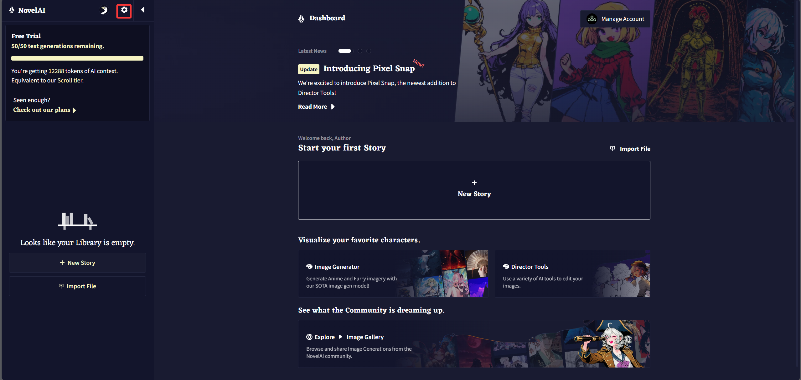
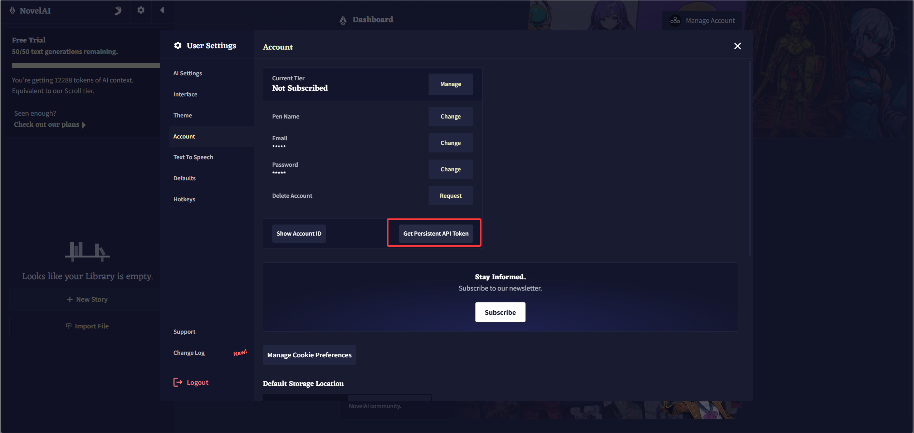
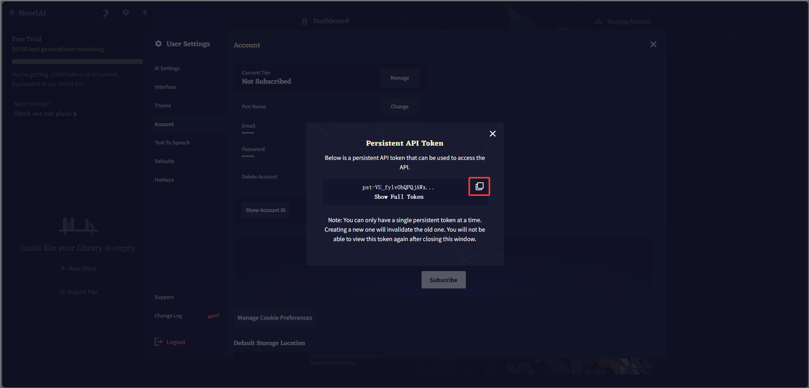

# ComfyUI_LLMAIDraw

面向 ComfyUI 的在线绘图节点（原 ComfyUI_NAIDGenerator-neo）：

- **NovelAI**：NAI Diffusion V5、文本生成、图生图、局部重绘、V3/V4 Vibe Transfer 以及 Director Tools。
- **GPT Image**：OpenAI 图像生成与编辑，支持 API Key 或 ChatGPT 账号登录。
- **Nano Banana 2**：Google Gemini 图像生成与参考图编辑。
- **Grok Image**：xAI 图像生成。
- **Seedream 5.5**：ByteDance Seedream 5.5 文生图，通过 Wavespeed API 调用，支持透明背景输出、宽高比选择和 1K/1.5K/2K 分辨率档位。
- **Seedream 5.5 Edit**：Seedream 5.5 图像编辑，支持最多 10 张参考图、多轮一致编辑。

## 安装

在 ComfyUI 的 `custom_nodes` 目录执行：

```bash
git clone https://github.com/chen079/ComfyUI_LLMAIDraw.git
```
```bash
python -m pip install -r ComfyUI_LLMAIDraw/requirements.txt
```

NovelAI 节点位于 `NAI Neo` 分类，其余节点位于 `LLMAIDraw` 分类。

## 配置文件

所有凭据都写在插件目录的 `config.json` 中。首次使用时复制 `config.example.json`：

```powershell
Set-Location ComfyUI/custom_nodes/ComfyUI_LLMAIDraw
Copy-Item config.example.json config.json
notepad config.json
```

```json
{
  "novelai": { "access_token": "pst-你的完整令牌" },
  "gpt_image": {
    "official": { "base_url": "https://api.openai.com/v1", "api_key": "sk-..." },
    "my-proxy": { "base_url": "https://your-proxy.example/v1", "api_key": "sk-..." }
  },
  "nano_banana": {
    "official": { "base_url": "https://generativelanguage.googleapis.com/v1beta", "api_key": "AIza..." }
  },
  "grok_image": {
    "official": { "base_url": "https://api.x.ai/v1", "api_key": "xai-..." }
  },
  "seedream": {
    "official": { "base_url": "https://api.wavespeed.ai/api/v3", "api_key": "your-wavespeed-key" }
  },
  "chatgpt_account": { "model": "gpt-6.1-sol" }
}
```

- `gpt_image`、`nano_banana`、`grok_image`、`seedream` 下的每个键都是一个配置，可以同时写官方地址和任意多个自定义地址；节点的 `profile` 下拉框按名称选择。自定义地址需要兼容对应服务的官方接口格式（OpenAI Images、Gemini `generateContent`、xAI Images、Wavespeed v3）。
- 修改 `config.json` 中的 `base_url` / `api_key` 后立即生效；新增或删除配置名称后需要刷新页面或重启 ComfyUI，下拉框才会更新。
- `config.json` 已在 `.gitignore` 中，不会被提交。

## ChatGPT 账号登录（GPT Image）

在 `LLMAIDraw · GPT Image` 节点把 `profile` 选为 `chatgpt_account` 即可使用 ChatGPT 账号额度绘图：

1. 首次运行时，节点会在本机浏览器打开 ChatGPT 登录页（控制台也会打印登录链接），登录后回到 ComfyUI，生成会继续进行。
2. 登录结果保存在 `config.json` 的 `chatgpt_account` 中，过期后自动刷新。需要切换账号时打开节点的 `force_login`。
3. 登录回调使用本机 `localhost:1455` 端口，必须在运行 ComfyUI 的同一台电脑上的浏览器完成登录。

该方式使用与 Codex CLI "Sign in with ChatGPT" 相同的登录流程和 ChatGPT 内部接口，不是 OpenAI 公开 API，可能随时变更或失效；`chatgpt_account.model` 为调用绘图工具的对话模型。Nano Banana 2 与 Grok Image 没有官方的账号登录接口，只支持 `base_url` + `api_key`。

## 节点参数

- `LLMAIDraw · GPT Image`：`model`（默认 `gpt-image-2.6-sunburst`，下拉框内置 2.6/2.5 的 Sunburst 和更快的 Flare）、`size`（最高 4K，超过 2560x1440 为实验性）、`quality`（含 2.5 新增的 `xhigh`/`max`）、`background`（`transparent` 时输出带透明通道，需 png/webp）、`output_format`、`output_compression`、`moderation`、`n`。连接 `image` 时改为图像编辑，批次中的每张图都作为参考图；`mask` 白色区域为编辑区域。
- `LLMAIDraw · Nano Banana 2`：`model`（默认 `gemini-3.1-flash-image`）、`aspect_ratio`、`image_size`（1K/2K/4K）、`temperature`，可选参考图 `image`。
- GPT Image 与 Nano Banana 2 支持多参考图：每连接一个参考图会自动增加一个空的参考图输入，所有输入按顺序发送。
- `LLMAIDraw · Grok Image`：`model`（默认 `grok-imagine-image-2.0`）、`aspect_ratio`、`resolution`（1k/2k）、`quality`、`n`。
- `LLMAIDraw · Seedream 5.5`：`aspect_ratio`、`resolution`（1k/1.5k/2k，1k 与 1.5k 同价，2k 最高）、`background`（`transparent` 返回带透明通道的图像，需 png；`auto` 由模型根据提示词和输出格式决定）、`output_format`（png/jpeg）。Seedream 5.5 为文生图，不支持参考图与种子。
- `LLMAIDraw · Seedream 5.5 Edit`：同上参数，另加可选 `image` 参考图输入（最多 10 张，连接参考图后自动增加输入插槽）；`aspect_ratio` 额外支持 `auto`，由模型从输入图像自动推断宽高比。
- 三个节点都有可选的 `custom_model` 文本框：填写后代替 `model` 下拉框使用，可直接输入下拉框中没有的模型名；留空时使用 `model`。Seedream 5.5 节点没有 `model` 和 `custom_model`，模型固定为 `bytedance/seedream-v5.5`。

## 获取模型列表

三个 LLMAIDraw 节点（GPT Image、Nano Banana 2、Grok Image）都有 **获取模型列表 / Refresh models** 按钮：先选好 `profile`，点击后会请求该配置的 `/models` 接口，把模型写入 `config.json` 中该配置的 `models` 字段，并刷新 `model` 下拉框。列表包含该接口返回的全部模型，请自行选择图像模型。下拉框中没有的模型可以填写在 `custom_model` 中，不为空时代替 `model` 使用。

不支持 `/models` 的中转站可以手动填写列表：

```json
"gpt_image": {
  "my-proxy": { "base_url": "https://your-proxy.example/v1", "api_key": "sk-...", "models": ["gpt-image-2.6-sunburst"] }
}
```

`chatgpt_account` 不使用 `model` 下拉框，也没有模型列表：图像模型由 ChatGPT 服务端选择，无法指定；`config.json` 中的 `chatgpt_account.model`（默认 `gpt-6.1-sol`）只是调用绘图工具的对话模型。

GPT Image、Nano Banana 2、Grok Image 和 Seedream 5.5 的接口不支持种子，因此节点没有 `seed`；输入完全相同时 ComfyUI 会复用缓存结果，修改提示词等输入即可重新生成。所有节点只输出 `IMAGE`，需要保存时连接 `SaveImage`。

界面提供英文和简体中文翻译，跟随 ComfyUI 的语言设置自动切换。节点 ID、端口类型和下拉选项值不会随界面语言改变，因此切换语言不会影响工作流。

## 获取 NovelAI API Token

NovelAI 在界面中将这里使用的密钥称为 **Persistent API Token**。

1. 打开 [NovelAI Stories](https://novelai.net/stories) 并登录，在页面左上角点击齿轮按钮，打开 **User Settings**。

   

2. 在左侧选择 **Account**，然后点击 **Get Persistent API Token**。

   

3. 在弹窗中点击 **Show Full Token** 显示完整令牌，再点击右侧复制按钮。令牌通常以 `pst-` 开头。

   

4. 妥善保存令牌。NovelAI 同一时间只允许一个 Persistent API Token；创建新令牌会使旧令牌失效。

## 配置 NovelAI Token

把令牌写入 `config.json` 的 `novelai.access_token`，保存后重启 ComfyUI。旧版本的 `.env` 不再读取，请把其中 `NAI_ACCESS_TOKEN=` 后面的值迁移过来。

如果提示 `Set novelai.access_token`，请检查：

- `config.json` 位于 `ComfyUI_LLMAIDraw` 目录，与 `nodes.py` 同级，且文件名不是 `config.json.txt`。
- JSON 格式正确（键和值都使用英文双引号）。
- 如果刚生成过新令牌，没有继续使用已失效的旧令牌。

## 节点

- `NAI Neo · Generate`：生成图片，只返回 ComfyUI `IMAGE`，不会自动保存文件。
- `NAI Neo · ModelOption`：选择 NovelAI 模型。
- `NAI Neo · Img2ImgOption`：配置图生图。
- `NAI Neo · InpaintingOption`：配置局部重绘。
- `NAI Neo · EncodeVibe`：为 V4/V4.5 编码参考图。
- `NAI Neo · VibeTransferOption`：设置 Vibe 强度并组合多个参考。
- `NAI Neo · NetworkOption`：设置生成请求的超时、重试和错误忽略策略。
- `NAI Neo · RemoveBG`、`LineArt`、`Sketch`、`Colorize`、`Emotion`、`Declutter`：NovelAI Director Tools。

NAI Diffusion V5 Curated 和 V5 Full 可在 Model Option 中选择，默认模型仍为 V4.5 Full。V5 当前不支持 Vibe Transfer；V5 Curated 局部重绘会使用 NovelAI 当前提供的 V4.5 Curated Inpainting 模型。

## V4 / V4.5 Vibe Transfer

```text
Load Image → NAI Neo · EncodeVibe
NAI Neo · EncodeVibe → NAI Neo · VibeTransferOption.encoded_vibe
NAI Neo · VibeTransferOption → NAI Neo · Generate.option
```

`information_extracted` 在 Encode Vibe 节点设置，修改它或参考图会重新编码。`strength` 在 Vibe Transfer Option 节点设置，修改它可以复用未失效的编码结果。NovelAI 通常对一次新编码收取 2 Anlas；ComfyUI 缓存失效或重启后可能再次编码。

V3 模型可以把原图直接连接到 Vibe Transfer Option 的 `image`。V4/V4.5 必须先经过 Encode Vibe。编码模型与生成模型必须一致。

## 保存图片

Generate 和 Director 节点不会写入 `output`。需要保存时，请连接 ComfyUI 自带的 `SaveImage` 节点；只想查看时可以连接预览节点。

## 迁移说明

本项目使用 `NAINeo...` 节点 ID 及 `NAI_NEO_OPTION`、`NAI_NEO_VIBE` 端口类型。原项目节点不会被注册，旧工作流需要重新添加并连接 NAI Neo 节点。

## 目录结构

```text
ComfyUI_LLMAIDraw/
├── __init__.py          # 注册全部节点
├── config.py            # 读取 / 保存 config.json
├── config.example.json  # 配置模板
├── http_errors.py       # 统一的请求错误信息
├── image_codec.py       # ComfyUI 图像与 PNG / 遮罩互转
├── nai/                 # NovelAI：请求、生成参数、提示词语法、节点
├── llm/                 # GPT Image / Nano Banana 2 / Grok Image 及 ChatGPT 账号登录
├── web/                 # 前端扩展：获取模型列表按钮
├── locales/             # 中英文界面翻译
├── workflows/           # 示例工作流
├── docs/images/         # 文档截图
└── tests/
```

## 致谢与许可

本项目最初基于 [bedovyy/ComfyUI_NAIDGenerator](https://github.com/bedovyy/ComfyUI_NAIDGenerator) 开展，感谢原作者和贡献者提供的基础工作。

此后项目采用独立的节点标识、代码结构、请求模块、图片转换模块、提示词模块、测试和文档。项目仍按照原项目采用的 GNU GPL v3 发布；完整条款见 [LICENSE](LICENSE)。NovelAI、ComfyUI 及相关名称和商标归各自权利人所有，本项目不是 NovelAI 或 ComfyUI 官方项目。
